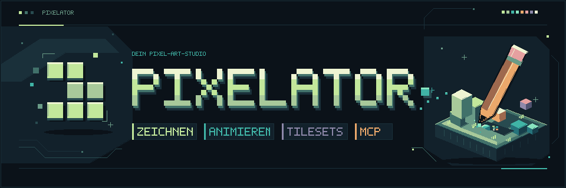
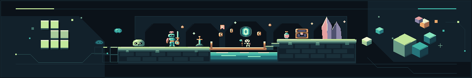

# Pixelator

Lokaler Pixel-Art-Editor mit MCP für Codex, Claude und Antigravity. Benötigt Node.js **ab 24.13**.

## Features

- Projekte und Stilprofile
- Ebenen mit Sichtbarkeit, Sperren, Duplikaten und Zusammenführen
- Stift, Radierer, Pipette, Linien, Formen und Polygon
- Pinselgrößen, Dithering-Muster, Schattieren und Zweitfarbe
- Füllen: zusammenhängend/global, Ebene/Gesamtbild
- Rechteckauswahl, Lasso und Zauberstab; Verschieben und Kopieren
- Zwischenablage zwischen Assets und mit anderen Programmen
- Spiegeln, Drehen, Kontur und Farbe ersetzen
- Leinwandgröße ändern und zuschneiden
- Zeichensymmetrie und Pixel-Perfect-Stift
- Paletten mit Import/Export (GPL, PAL, HEX) und Transparenz
- Referenzbild zum Abpausen
- Tilesets mit Kachelraster, Kollision und Terrain
- Autotiles (Blob, Kanten, Ecken) aus fünf Schlüsselkacheln und Terrain-Testkarte
- Nahtloses Zeichnen
- Tileset-Export für Tiled, Godot und Unity
- Zoom, Handwerkzeug, Raster und Tastenkürzel
- Größenverstellbare Bereiche mit gespeicherter Fensteraufteilung
- Vorschau mit 3×3-Kachelung
- Revisionen, Rückgängig und Wiederholen
- Asset-Varianten
- Animation: Frames, Dauer pro Frame, Tags, Onion Skin und Wiedergabe
- PNG-, Sprite-Sheet- und Projektimport
- PNG-/JSON-Export, Sprite-Sheet mit Aseprite-JSON, GIF und Unity-Metadaten mit Pivot; Bildexporte 1–16×
- MCP-Aufträge, Bildinspektion, kompakte Rasterein-/ausgabe und Agentenstatus

## Start

```powershell
npm install
npm run build
npm start
```

[Editor öffnen](http://127.0.0.1:4317). Das Terminal während der Nutzung geöffnet lassen.

## MCP verbinden

Bei laufender App und eingeschaltetem MCP-Server:

```powershell
# Codex
codex mcp add pixelator --url http://127.0.0.1:4317/mcp

# Claude Code
claude mcp add --transport http pixelator http://127.0.0.1:4317/mcp --scope user
```

**Antigravity:** Unter **MCP Servers → Manage MCP Servers → View raw config** ergänzen; vorhandene Server beibehalten:

```json
{ "mcpServers": { "pixelator": { "serverUrl": "http://127.0.0.1:4317/mcp" } } }
```

Danach die MCP-Verbindung im Client neu laden. [Weitere Details](docs/mcp.md) · [Editor](docs/editor.md) · [Tiles](docs/tiles.md) · [Tests](docs/testing.md)

Daten liegen in `data/`. Für Backups die App beenden und den Ordner sichern.


