# Generated examples

Claude agents generated these assets for a small 2D game, working in Pixelator over MCP. Every sprite shares one 31-color palette and was exported as a sprite sheet with Aseprite JSON. The images below are scaled up 2–5× without smoothing.

## Characters

Six playable heroes, 16×16, each with 12 animations.

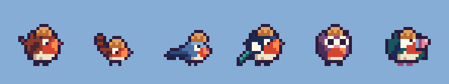

The move set of one hero: jump arc, ground slam, hit and reel, defeat.

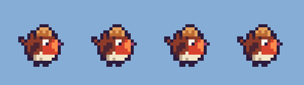

## Enemies

16×16, 16×8 and 24×16 enemies, each with 2–5 animations.

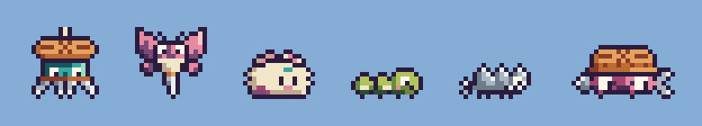

## Bosses

Five bosses. Each action loops on its own.

### Moth queen

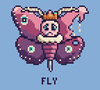 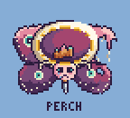 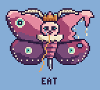 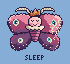 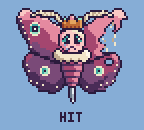 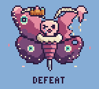

### Pincushion tomato

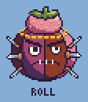 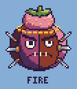 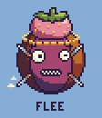 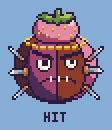 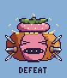

### Steam iron

 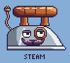 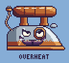 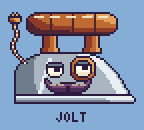 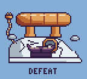

### Shears

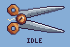 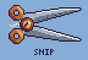 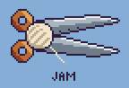 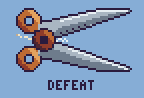

### Seam ripper

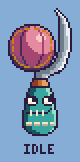 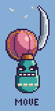 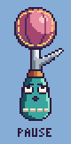  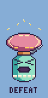

## Effects and pickups

Hit, burst, sparkle, landing and slam effects, plus collectible pickups.

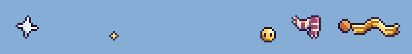

## Backgrounds

A dawn sky and a window in night and day versions.

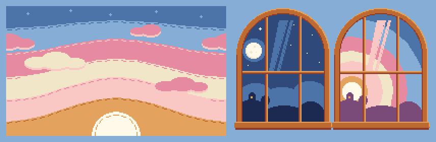
