# Horse Benchmark results

All runs of the [Horse Benchmark](horse-benchmark.md), on 2026-11-20 and 2026-11-21. Every model ran at the highest reasoning effort its client offered. All runs shared the normal data folder of one Pixelator instance, several at the same time; no model opened another model's project, and none computed pixels with code.

Time runs from the prompt to the model's last message. Batches and reviews are counted by Pixelator. API cost is what a run would have cost at the published API prices of 2026-11-21, computed from the token counts the client logged (Codex fast-mode runs at OpenAI's Fast rates, Antigravity helper calls at Gemini 3.8 Flash rates); the runs themselves used subscriptions.

## OpenAI

"Fast mode" marks runs with Codex fast mode switched on.

| Model | Client | Effort | Time | API cost | Batches | Reviews | Notes |
| --- | --- | --- | --- | --- | --- | --- | --- |
| gpt-5.6-luna | Codex Desktop 0.171.0-alpha.13 | max | 8 min (fast mode) | $0.25 | 11 | 4 | Named itself "GPT-5". |
| gpt-6-luna | Codex Desktop 0.171.0-alpha.13 | max | 15 min (fast mode) | $0.18 | 11 | 2 | Named itself "GPT-6". |
| gpt-5.6-terra | Codex Desktop 0.171.0-alpha.13 | max | 10 min (fast mode) | $2.16 | 8 | 2 | Named itself "GPT-5". |
| gpt-6.1-terra | Codex Desktop 0.171.0-alpha.13 | max | 6 min (fast mode) | $1.05 | 10 | 5 | Named itself "GPT-6". |
| gpt-5.6-sol | Codex Desktop 0.171.0-alpha.13 | max | 8 min (fast mode) | $4.30 | 7 | 4 | Named itself "GPT-5". |
| gpt-6-sol | Codex Desktop 0.171.0-alpha.13 | max | 7 min (fast mode) | $1.68 | 7 | 3 | Named itself "GPT-6". |
| gpt-6.1-sol | Codex Desktop 0.171.0-alpha.13 | max | 16 min (fast mode) | $1.95 | 12 | 3 | Named itself "GPT-6". |
| gpt-6.2-sol | Codex Desktop 0.171.0-alpha.13 | max | 16 min (fast mode) | $2.56 | 15 | 3 | Listed the projects but opened none; named itself "GPT-6". |
| gpt-6-astra | Codex Desktop 0.171.0-alpha.13 | max | 17 min | $5.98 | 11 | 4 | Finished as needs_review; named itself "GPT-6". |
| gpt-6.2-astra | Codex Desktop 0.171.0-alpha.13 | max | 38 min | $8.03 | 23 | 8 | Listed the projects but opened none; named itself "GPT-6". |

| | 5.6 | 6 | 6.1 | 6.2 |
| --- | :---: | :---: | :---: | :---: |
| **luna** | 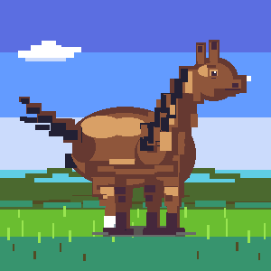 | 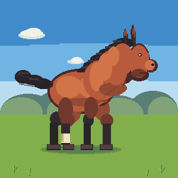 | | |
| **terra** | 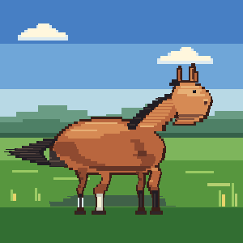 | | 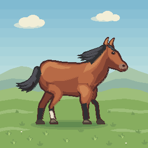 | |
| **sol** | 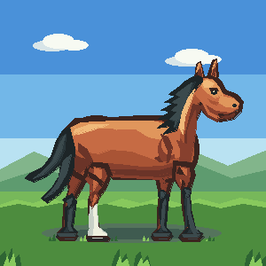 | 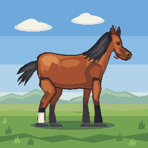 | 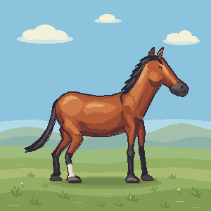 | 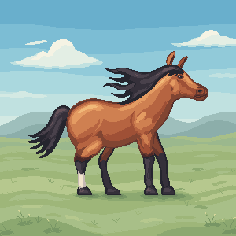 |
| **astra** | | 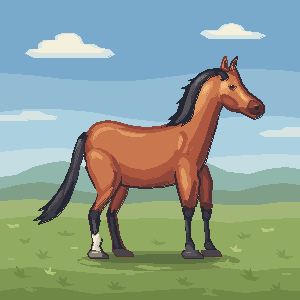 | | 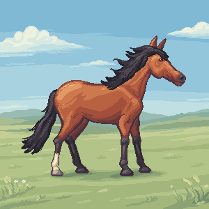 |

## Anthropic

| Model | Client | Effort | Time | API cost | Batches | Reviews | Notes |
| --- | --- | --- | --- | --- | --- | --- | --- |
| claude-haiku-4-5 | Claude Desktop (Claude Code 2.1.328) | none, extended thinking | 6 min | $0.80 | 16 | 2 | Named itself "Claude-Haiku-4-5-20251001". |
| claude-haiku-5-5 | Claude Desktop (Claude Code 2.1.328) | max | 43 min | $3.17 | 19 | 2 | Two read-only reviewer subagents; finished as needs_review; named itself "Claude Haiku 5.5". |
| claude-sonnet-4-6 | Claude Desktop (Claude Code 2.1.328) | max | 35 min | $4.19 | 11 | 1 | Context ran out once and was summarized automatically; finished as needs_review; named itself "claude-sonnet-4-6". |
| claude-sonnet-5 | Claude Desktop (Claude Code 2.1.328) | max | 31 min | $5.26 | 12 | 2 | The client resumed once by itself after a cut-off response; named itself "Claude Sonnet 5". |
| claude-sonnet-5-5 | Claude Desktop (Claude Code 2.1.328) | max | 86 min | $21.58 | 42 | 3 | Two read-only reviewer subagents (one independent review recorded); context ran out once and was summarized automatically; stopped at usage limit as needs_review; named itself "Claude Sonnet 5.5". |
| claude-opus-4-6 | Claude Desktop (Claude Code 2.1.328) | max | 72 min | $12.62 | 11 | 2 | Hit the usage limit and was resumed the next morning with one "continue" (time without the pause); context ran out three times and was summarized automatically; named itself "Claude Opus 4.6". |
| claude-opus-4-7 | Claude Desktop (Claude Code 2.1.328) | max | 31 min | $15.47 | 23 | 3 | Named itself "Opus 4.7". |
| claude-opus-4-8 | Claude Desktop (Claude Code 2.1.328) | max | 85 min | $32.19 | 28 | 2 | Hit the usage limit and was resumed the next morning with one "try again" (time without the pause); two read-only reviewer subagents; named itself "Opus 4.8". |
| claude-opus-5 | Claude Desktop (Claude Code 2.1.328) | max | 115 min | $42.85 | 33 | 3 | One read-only reviewer subagent (its review recorded as independent); the client resumed once by itself after a cut-off response; finished as needs_review; named itself "Opus 5". |
| claude-opus-5-5 | Claude Desktop (Claude Code 2.1.328) | max | 217 min | $67.65 | 57 | 7 | Four read-only reviewer subagents (four independent reviews recorded); context ran out once and was summarized automatically; a first attempt the evening before stopped at the usage limit and is not counted; named itself "Claude Opus 5.5". |

| haiku | sonnet | opus |
| :---: | :---: | :---: |
| 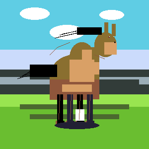 4.5 |  4.6 |  4.6 |
| | | 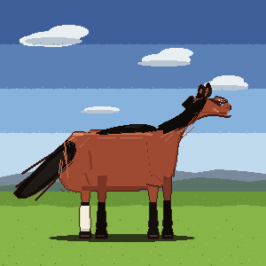 4.7 |
| | | 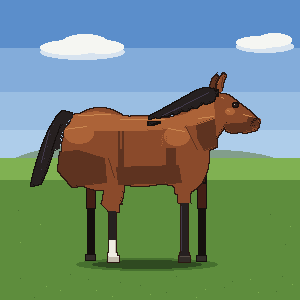 4.8 |
| | 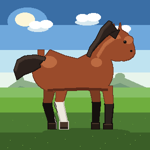 5 | 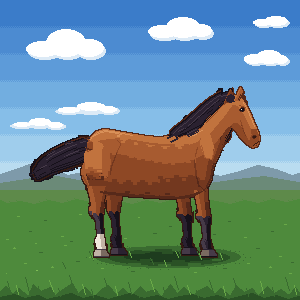 5 |
| 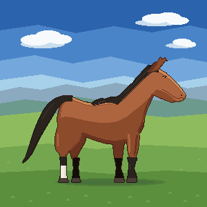 5.5 |  5.5 | 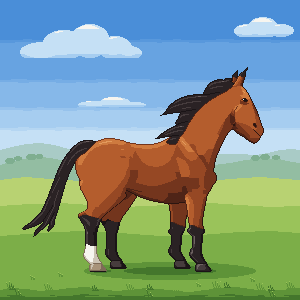 5.5 |

## Google

| Model | Client | Effort | Time | API cost | Batches | Reviews | Notes |
| --- | --- | --- | --- | --- | --- | --- | --- |
| gemini-3.8-flash | Antigravity 2.33.1 | high | 14 min | $0.80 | 6 | 3 | Named itself "Gemini 3.8 Flash". |
| gemini-4-argon | Antigravity 2.33.1 | high | 32 min | $2.79 | 15 | 6 | Named itself "Gemini 4 Argon (High)". |
| gemini-4-hydrogen | Antigravity 2.33.1 | xhigh | 32 min | $6.17 | 29 | 4 | One review by an independent subagent; named itself "Gemini 4 Hydrogen". |
| gemini-4-neon | Antigravity 2.33.1 | xhigh | 93 min | $19.00 | 30 | 5 | Three reviews by independent subagents; named itself "Gemini 4 Neon". |

| gemini-3.8-flash | gemini-4-argon | gemini-4-hydrogen | gemini-4-neon |
| :---: | :---: | :---: | :---: |
| 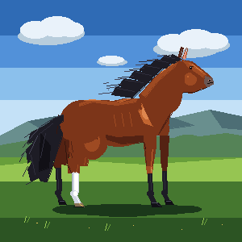 | 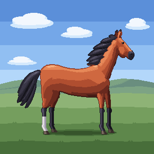 | 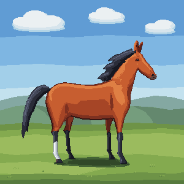 | 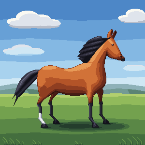 |
